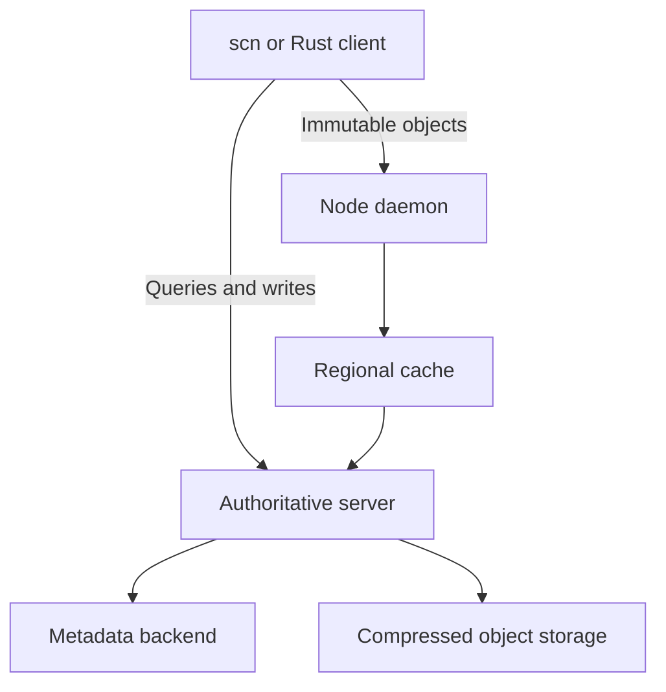

# Scion

**Source control for online clients, large repositories, and reusable infrastructure.**

[](https://github.com/wieslawsoltes/scion/actions/workflows/ci.yml)
[](https://github.com/wieslawsoltes/scion/actions/workflows/release.yml)
[](https://www.rust-lang.org/)
[](#license)

Scion is a Rust source-control system with immutable changesets, content-addressed storage, server-side repository operations, sparse working copies, and shared object caches. Its implementation is divided into reusable crates so applications can use the model, storage, graph algorithms, repository engine, or HTTP client independently.

The architectural reference is Anthropic's [public Scion design](https://www.anthropic.com/research/redesigning-source-control). This project is independent and unaffiliated with Anthropic. It defines its own public formats and API; it does not claim wire compatibility with Anthropic's private service. See [public design and coverage](docs/public-design.md) for the requirement mapping and boundaries.

## Design

A changeset records changed files relative to its first parent. Immutable content can be shared immediately without moving a branch. Named references use a separate compare-and-swap operation. The server handles graph and history queries, diffs, merges, rebases, and reverts; clients fetch the specific trees and blobs they need.

The object path and control path are separate:



The cache tiers share one object protocol. Object capabilities bind authorization to a repository, revision, path, content ID, and expiry. A content hash alone grants no read access.

## Build and install

Use Rust 1.88 or later and a C compiler. Git is required for Git migration. Use a current stable Cargo for workspace package verification.

```sh
git clone https://github.com/wieslawsoltes/scion.git
cd scion
cargo build --workspace --bins --release --locked
```

The executables are in `target/release`:

| Binary | Role |
|---|---|
| `scn` | Command-line client and Git migration |
| `scion-server` | Authoritative source-control service |
| `scion-cache` | Regional immutable-object cache |
| `scion-daemon` | Shared node cache with optional Unix socket |

To install the commands from this checkout:

```sh
cargo install --path crates/scion-cli --locked
cargo install --path crates/scion-server --locked
cargo install --path crates/scion-cache --locked
```

Tagged releases are built for Linux x64/ARM64, macOS x64/ARM64, and Windows x64. [Release documentation](docs/releases.md) explains binary bundles, crate archives, checksums, and registry publication.

## Quick start

Start a local development authority in one terminal:

```sh
scion-server --dev --data ./scion-data --listen 127.0.0.1:7420
```

In another terminal:

```sh
export SCION_SERVER=http://127.0.0.1:7420
export SCION_REPO=demo

scn init --author "Ada <ada@example.test>" --message "Initialize repository"
scn clone main work
cd work
printf 'Hello, Scion!\n' > hello.txt
scn status
scn commit -m "Add greeting" --author "Ada <ada@example.test>" --ref main
scn log main
scn cat main hello.txt
```

`--dev` is an explicit local-development mode. For authenticated deployments, configure a policy and a capability signing key; see [operations](docs/operations.md).

### Sparse and lazy checkouts

```sh
scn clone main frontend-work --sparse apps/frontend --sparse crates/shared
scn clone main lazy-work --sparse apps/frontend --lazy
cd lazy-work
scn hydrate apps/frontend
```

Sparse selection excludes unrelated subtrees. Lazy checkout records tracked files without downloading their contents until hydration. Linux also has an optional read-only FUSE mount for transparent file access. See [the command guide](docs/commands.md#linux-filesystem-mount) for that workflow.

### Automation without a checkout

```sh
scn --json refs
scn --json log main
scn --json diff BASE_CHANGESET TARGET_CHANGESET
scn --json blame main src/lib.rs
scn --json search main Cargo.toml
```

The reusable client exposes the same service protocol. See [commands](docs/commands.md) and [HTTP protocol](docs/protocol.md) for request and response details.

## Reusable crates

| Crate | Responsibility |
|---|---|
| [`scion-types`](crates/scion-types) | Validated paths, object IDs, changesets, trees, diffs, and shared errors |
| [`scion-store`](crates/scion-store) | Immutable object encoding and interchangeable storage backends |
| [`scion-graph`](crates/scion-graph) | Commit DAG, generations, skip pointers, ancestry, and merge bases |
| [`scion-engine`](crates/scion-engine) | Incremental trees, derived data, repository queries and mutations |
| [`scion-protocol`](crates/scion-protocol) | Versioned JSON RPCs, service tiers, and object capabilities |
| [`scion-server`](crates/scion-server) | HTTP authority, access policy, resource limits, and telemetry |
| [`scion-client`](crates/scion-client) | Typed network client and sparse/lazy working-copy management |
| [`scion-cache`](crates/scion-cache) | Bounded persistent object cache, proxy service, and node daemon |
| [`scion-git`](crates/scion-git) | Incremental Git ingestion and durable object-ID mappings |
| [`scion-cli`](crates/scion-cli) | Reusable command runner and `scn` executable |

All product crates carry package metadata and versioned internal dependencies. CI packages and rebuilds them as archives. Publication to crates.io is separately configured; packageability does not imply a version is already published.

## Documentation

| Guide | Contents |
|---|---|
| [Architecture](docs/architecture.md) | Object model, storage boundaries, tree updates, derived data, and graph queries |
| [Public design and coverage](docs/public-design.md) | Sources, implementation contracts, validation, and known boundaries |
| [Commands](docs/commands.md) | Everyday workflows, checkout-free operations, and Git migration |
| [Protocol](docs/protocol.md) | Control RPCs, binary object format, capabilities, errors, and compatibility |
| [Operations](docs/operations.md) | Deployment, identity policy, caches, persistence, recovery, and diagnostics |
| [Testing and performance](docs/testing.md) | Test suites, fuzz targets, measurement methodology |
| [Build and release](docs/releases.md) | CI, native assets, checksums, and topological crate publication |
| [Contributing](CONTRIBUTING.md) | Development setup and change invariants |
| [Security](SECURITY.md) | Disclosure process and trust boundaries |

Generate API documentation locally with `cargo doc --workspace --all-features --no-deps --open`.

## Validation

```sh
cargo fmt --all -- --check
cargo clippy --workspace --all-targets --all-features --locked -- -D warnings
cargo test --workspace --all-features --locked
cargo doc --workspace --all-features --no-deps --locked
cargo package --workspace --all-features --locked
```

CI exercises Linux, macOS, and Windows and checks the minimum compiler version. Fuzz targets exercise path validation, canonical objects, and compressed envelopes. Release jobs build each advertised binary target natively. Production-scale throughput and availability must be measured with the intended workload; this repository does not claim Anthropic's reported infrastructure speedups as its own results.

## License

Licensed under either the [MIT license](LICENSE-MIT) or the [Apache License, Version 2.0](LICENSE-APACHE), at your option.
