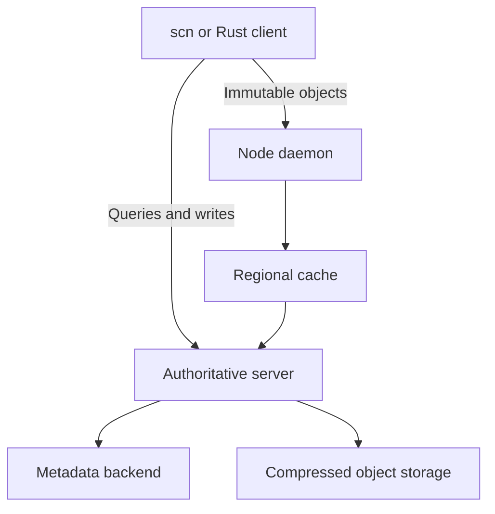

# Scion

**Source control for online clients, large repositories, and reusable infrastructure.**

[](https://github.com/wieslawsoltes/scion/actions/workflows/ci.yml)
[](https://github.com/wieslawsoltes/scion/actions/workflows/release.yml)
[](https://www.rust-lang.org/)
[](#license)

Scion is a Rust source-control system with immutable changesets, server-side repository operations, sparse and virtual working copies, and shared object caches. Thirteen reusable crates separate the data model, storage adapters, graph algorithms, repository engine, identity policy, network protocol, and clients. Applications can embed the libraries without running the complete service topology.

The architectural reference is Anthropic's [public Scion design](https://www.anthropic.com/research/redesigning-source-control). This project is independent and unaffiliated with Anthropic. It defines its own public formats and API; it does not claim wire compatibility with Anthropic's private service. See [public design and coverage](docs/public-design.md) for the requirement mapping and boundaries.

## Design

A changeset records changed files relative to its first parent. Immutable content can be shared immediately without moving a branch. Named references use a separate compare-and-swap operation. The server handles graph and history queries, diffs, merges, rebases, and reverts; clients fetch the specific trees and blobs they need.

The object path and control path are separate:



The cache tiers share one object protocol. Object capabilities bind authorization to a repository, revision, path, content ID, and expiry. A content hash alone grants no read access.

## Capabilities

| Area | Included |
|---|---|
| Repository operations | Commits, diffs, history, blame, copies, path search, ancestry, merge bases, recursive three-way merges, rebase, revert, and bisection |
| Working copies | Ordinary and sparse checkouts, explicit lazy hydration, incremental status, journaled checkout recovery, and filesystem notifications |
| Virtual filesystems | Durable writable overlay API; Linux FUSE for transparent reads and writes, inode lifetime tracking, and commit integration |
| Persistence | SQLite, PostgreSQL, Spanner metadata, hash-partitioned objects, and S3/GCS/Azure object adapters |
| Identity and access | Static bearer credentials, configured OIDC/JWKS identity providers, atomic policy reload, repository/directory rules, and signed object capabilities |
| Shared infrastructure | Byte-bounded caches, coalesced misses, enforced cache tiers, circuit breakers, snapshots, resource limits, and telemetry |
| Git migration | Streaming import/export, restartable object-ID mappings, executable/symlink/submodule modes, and SHA-256 repository support |
| Distribution | Four binaries, thirteen packageable crates, five native release targets, checksums, and optional dependency-ordered crates.io publication |

See the [coverage matrix](docs/public-design.md) for implementation contracts and the [Git comparison](docs/git-comparison.md) for measured results and remaining performance limits.

## Build and install

Use Rust 1.88 or later and a C compiler. Git is required for Git migration. Use a current stable Cargo for workspace package verification.

```sh
git clone https://github.com/wieslawsoltes/scion.git
cd scion
cargo build --workspace --bins --release --all-features --locked
```

The executables are in `target/release`:

| Binary | Role |
|---|---|
| `scn` | Command-line client and Git migration |
| `scion-server` | Authoritative source-control service |
| `scion-cache` | Regional immutable-object cache |
| `scion-daemon` | Shared node cache with optional Unix socket |

To install the commands from this checkout:

```sh
cargo install --path crates/scion-cli --all-features --locked
cargo install --path crates/scion-server --all-features --locked
cargo install --path crates/scion-cache --all-features --locked
```

These commands enable PostgreSQL, cloud storage, Spanner, and the Linux FUSE client where applicable. Embedding applications can select only the features they need.

Tagged releases are built for Linux x64/ARM64, macOS x64/ARM64, and Windows x64. [Release documentation](docs/releases.md) explains binary bundles, crate archives, checksums, and registry publication.

## Quick start

Start a local development authority in one terminal:

```sh
scion-server --dev --data ./scion-data --listen 127.0.0.1:7420
```

In another terminal:

```sh
export SCION_SERVER=http://127.0.0.1:7420
export SCION_REPO=demo

scn init --author "Ada <ada@example.test>" --message "Initialize repository"
scn clone main work
cd work
printf 'Hello, Scion!\n' > hello.txt
scn status
scn commit -m "Add greeting" --author "Ada <ada@example.test>" --ref main
scn log main
scn cat main hello.txt
```

`--dev` is an explicit local-development mode. For authenticated deployments, configure a policy and a capability signing key; see [operations](docs/operations.md).

### Sparse and lazy checkouts

```sh
scn clone main frontend-work --sparse apps/frontend --sparse crates/shared
scn clone main lazy-work --sparse apps/frontend --lazy
cd lazy-work
scn hydrate apps/frontend
```

Sparse selection excludes unrelated subtrees. Lazy checkout records tracked files without downloading their contents until hydration. `scn status --stats` exposes verified cache hits and hashing work; `scn status --refresh` forces content verification.

### Writable virtual worktrees on Linux

```sh
mkdir -p /tmp/scion-work
scn mount main /tmp/scion-work --writable --overlay ./work-overlay \
  --uid "$(id -u)" --gid "$(id -g)"
# In another terminal, edit files under /tmp/scion-work, then:
scn overlay status ./work-overlay
scn overlay commit ./work-overlay -m "Update source" --author "Ada <ada@example.test>"
```

The mount fetches immutable file contents on access and keeps edits in a durable backing directory. The reusable overlay core also works without a kernel mount. See [working copies](docs/working-copies.md) for commit synchronization, sparse selection, restart behavior, and platform support.

### Automation without a checkout

```sh
scn --json refs
scn --json log main
scn --json diff BASE_CHANGESET TARGET_CHANGESET
scn --json blame main src/lib.rs
scn --json search main Cargo.toml
```

The reusable client exposes the same service protocol. See [commands](docs/commands.md) and [HTTP protocol](docs/protocol.md) for request and response details.

## Reusable crates

| Crate | Responsibility |
|---|---|
| [`scion-types`](crates/scion-types) | Validated paths, object IDs, changesets, trees, diffs, and shared errors |
| [`scion-store`](crates/scion-store) | Immutable object encoding, SQLite/PostgreSQL metadata, and object sharding |
| [`scion-store-cloud`](crates/scion-store-cloud) | Conditional immutable objects in S3, GCS, and Azure Blob Storage |
| [`scion-store-spanner`](crates/scion-store-spanner) | Transactional metadata, reference CAS, and publication logs in Spanner |
| [`scion-graph`](crates/scion-graph) | Commit DAG, generations, skip pointers, ancestry, and merge bases |
| [`scion-engine`](crates/scion-engine) | Incremental trees, derived data, repository queries and mutations |
| [`scion-protocol`](crates/scion-protocol) | Versioned JSON RPCs, service tiers, and object capabilities |
| [`scion-auth`](crates/scion-auth) | Bearer and OIDC/JWKS identity, directory policy, and atomic policy replacement |
| [`scion-server`](crates/scion-server) | HTTP authority, authorization enforcement, resource limits, and telemetry |
| [`scion-client`](crates/scion-client) | Typed client, sparse/lazy checkouts, durable overlays, and Linux FUSE |
| [`scion-cache`](crates/scion-cache) | Bounded persistent object cache, proxy service, and node daemon |
| [`scion-git`](crates/scion-git) | Incremental Git ingestion and durable object-ID mappings |
| [`scion-cli`](crates/scion-cli) | Reusable command runner and `scn` executable |

All product crates carry package metadata and versioned internal dependencies. CI packages and rebuilds them as archives. Publication to crates.io is separately configured; packageability does not imply a version is already published.

## Measured performance

The latest large-history three-way run compares the optimized build, a preserved
Scion baseline, and **Git 2.56.0**. It uses 100,000 file paths, a 100,000-commit
trunk, 10,000 commits per divergent arm, 31 samples per operation, and warm
operating-system caches. Both systems retain their documented durable-write
settings. Fresh queries include process startup and shutdown; prepared commits
and spread reads use resident workers.

Candidate graph queries use the explicit frozen graph API, prepared alongside
Git's native commit graph. Its 120,036-node artifact takes **6.320 seconds** to
export and **96,467,328 bytes** of additional storage. Reads, diffs, and writes use
ordinary LocalStore APIs. Preparation cost and frozen membership are part of the
feature's documented contract.

| Operation | Scion median | Git median | Scion improvement | Against Git |
|---|---:|---:|---:|---:|
| Prepared durable commit | 967.706 µs | 2,913.522 µs | 2.27× | 3.01× faster |
| Positive ancestry | 970.429 µs | 35,124.071 µs | 2.27× | 36.19× faster |
| Negative ancestry | 970.199 µs | 38,889.853 µs | 2.89× | 40.08× faster |
| Ancestor merge base | 898.230 µs | 32,357.663 µs | 2.29× | 36.02× faster |
| Divergent merge base | 862.837 µs | 8,296.653 µs | 2.74× | 9.62× faster |
| Fresh file read, 1 KiB | 1,189.358 µs | 1,445.924 µs | 1.95× | 1.22× faster |
| Fresh one-file text diff | 1,359.774 µs | 1,930.002 µs | 2.56× | 1.42× faster |
| Resident spread file read | 16.815 µs | 39.469 µs | 2.22× | 2.35× faster |

Every functional median in this fixture beats Git. Seven of eight improve by at
least 2× over the preserved Scion build; fresh reads reach 1.95×. The smaller
10,000-commit profile also beats Git in every functional row, with all four graph
queries exceeding 2× improvement; its prepared-commit and fresh-read improvements
remain below 2×. Controls and latency tails remain visible in the
[complete comparison](docs/git-comparison.md#frozen-graph-comparisons-25-october-2026),
alongside every raw sample, exact source/build identities, and earlier runs.
These local measurements do not establish a universal speedup or fleet throughput.

## Documentation

| Guide | Contents |
|---|---|
| [Architecture](docs/architecture.md) | Object model, storage boundaries, tree updates, derived data, and graph queries |
| [Public design and coverage](docs/public-design.md) | Sources, implementation contracts, validation, and known boundaries |
| [Commands](docs/commands.md) | Everyday workflows, checkout-free operations, and Git migration |
| [Frozen graph snapshots](docs/graph-snapshots.md) | Local prepared graph queries, export, integrity, bounds, and lifecycle |
| [Working copies](docs/working-copies.md) | Status caching, sparse/lazy files, writable overlays, mounts, and recovery |
| [Identity](docs/identity.md) | OIDC/JWKS trust, static credentials, directory grants, rotation, and policy reload |
| [Cloud objects](docs/cloud-storage.md) | S3/GCS/Azure configuration, integrity, credentials, and conformance tests |
| [Spanner metadata](docs/spanner.md) | Schema, transactions, committed log frontier, resource bounds, and emulator tests |
| [Protocol](docs/protocol.md) | Control RPCs, binary object format, capabilities, errors, and compatibility |
| [Operations](docs/operations.md) | Deployment, identity policy, caches, persistence, recovery, and diagnostics |
| [Testing and performance](docs/testing.md) | Test suites, fuzz targets, measurement methodology |
| [Engine performance](docs/performance.md) | Algorithm benchmarks, deterministic work bounds, and limits |
| [Durable Git comparison](docs/git-comparison.md) | Equivalent workloads, raw samples, latency distributions, and Git-winning cases |
| [Build and release](docs/releases.md) | CI, native assets, checksums, and topological crate publication |
| [Contributing](CONTRIBUTING.md) | Development setup and change invariants |
| [Security](SECURITY.md) | Disclosure process and trust boundaries |

Generate API documentation locally with `cargo doc --workspace --all-features --no-deps --open`.

## Validation

```sh
cargo fmt --all -- --check
cargo clippy --workspace --all-targets --all-features --locked -- -D warnings
cargo test --workspace --all-targets --all-features --locked
cargo test --workspace --doc --all-features --locked
cargo doc --workspace --all-features --no-deps --locked
cargo package --workspace --all-features --locked
```

CI exercises Linux, macOS, and Windows; verifies Rust 1.88 and every crate archive; and runs PostgreSQL, three-tier container, real Linux FUSE, MinIO, and official Spanner emulator integration tests. Fuzz targets cover paths, canonical objects, and compressed envelopes. The Git comparison workflow verifies equivalent outputs and retains raw timing samples. [Testing](docs/testing.md) links completed runs and explains what each gate establishes.

Performance is workload-specific. The latest complete fixture improves every functional median over Git, while the controls, latency tails, historical losses, and remaining 2× targets remain documented. Fleet throughput, availability, and Anthropic's reported infrastructure ratios are not established by these local measurements.

## License

Licensed under either the [MIT license](LICENSE-MIT) or the [Apache License, Version 2.0](LICENSE-APACHE), at your option.
